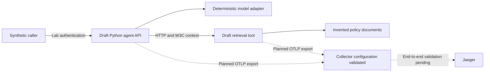
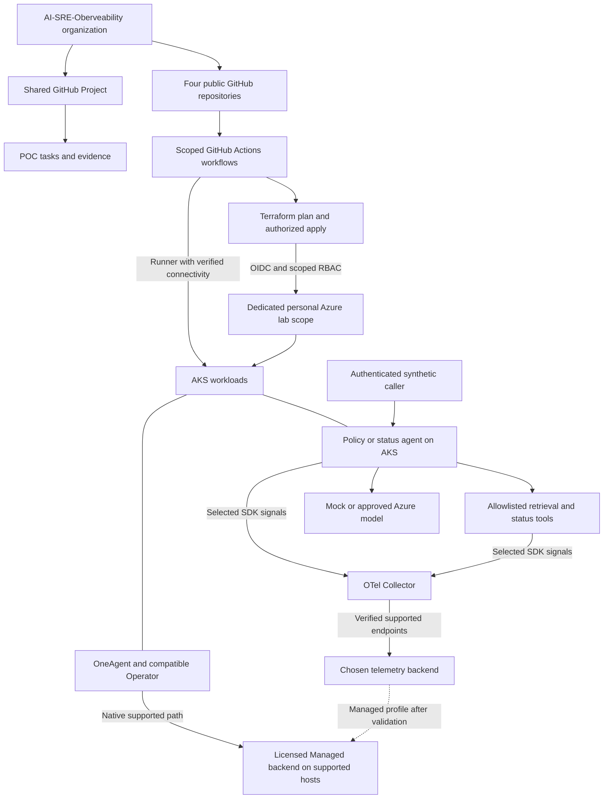
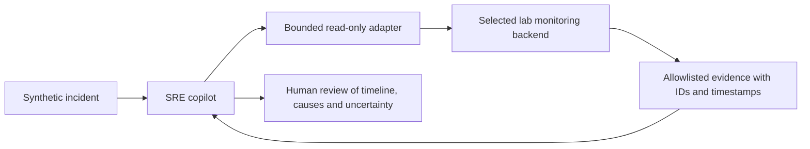

# High-level design — current, target and remaining work

Version: 0.8 CI active and guarded Terraform delivery. Updated: 29 October 2026, Asia/Dubai. Execution: **all four main-branch CI runs verified; protected Terraform workflow tested while disabled; Azure provisioning remains gated**.

## Purpose

Provide three synthetic use cases: a policy assistant, a service-status agent and a read-only SRE copilot. Observe AI workload behavior separately from using AI to investigate monitoring evidence. Use personal Azure/GitHub targets; preserve Dynatrace Managed as the preferred later compatibility profile.

Confirmed implementation choices: **Terraform owns Azure infrastructure**, Helm/Kubernetes manifests own workload/observability deployments, and four repositories under `AI-SRE-Oberveability` separate resource ownership. The organization is owned by the personal account `javedkumail`. All four transferred repositories retain their IDs, published commits and public visibility. The infrastructure destination is `AI-Observability-Infra`; other names match the source folders. Reviewed source is published to all four repositories; initial commit receipts are recorded below. GitLab credentials remain intact. Engineering standards are defined in `docs/engineering-standards.md`.

## Current local draft

Solid arrows describe the local service behavior exercised in the earlier 18-test run. Dashed arrows remain unproven as a complete running backend path. Existing in-memory trace assertions do not establish Jaeger ingestion. Collector and Jaeger binaries are present; local lifecycle coordination still needs work. The dependency-lock input is supplied and all four active main-branch CI workflows passed. This does not establish backend delivery. No live model, Azure or Managed deployment is present.

## Proposed personal Azure target

This diagram is a proposed target, not deployment proof. Infra owns Azure, state, identity and budgets; workloads owns applications/images/deployments; observability-config owns shared telemetry/monitoring; lab owns coordination/evidence. A release manifest pins their tested versions. The OneAgent native path stays independent of the arbitrary Collector. Separate experiments compare instrumentation modes and duplication.

Azure choices remain open: exact subscription/tenant, region, node sizes, public/private connectivity, reachable CI runner, model/quota, retention and active/idle cost. A costed plan precedes cloud spending. Managed choices additionally require entitlement, approved host/storage sizing and version compatibility.

## Read-only SRE path — planned

The adapter cannot execute arbitrary queries, shell commands or Azure/Kubernetes writes. Managed uses verified supported APIs; SaaS-only DQL/Grail, if selected, has separate configuration. Monitoring text is untrusted data. Every substantive claim references evidence or declares uncertainty.

## Nonfunctional design

- Operational metadata is the default capture policy; prompts, completions, documents, arguments and secrets stay out of telemetry.
- Fixed service/environment/version identity and W3C context enable cross-service trace validation. Metrics avoid user/conversation/trace labels.
- Execution and telemetry queues/retries are bounded. Mock token usage stays null; actual token budgets and dated cost estimates require a live provider.
- Synthetic load, short retention, explicit lifecycle commands and scoped IaC contain lab consumption. Budget notifications are not a guaranteed spending cutoff.
- Local, cloud, live-provider, Managed and optional SaaS evidence is labelled independently.

## HLD change log and next boundary

| Version | Change | Validation state |
| --- | --- | --- |
| 0.1 | Documented existing drafts, proposed Azure/Managed target and separate SRE evidence path | Plan awaiting user review |
| 0.2 | Confirmed Terraform, four private repositories under javedkumail, GitLab coexistence, event-driven tracker and engineering standards | User choices recorded; implementation still paused |
| 0.3 | Verified four public, empty GitHub destinations created by the user; recorded exact infrastructure name | Read-only API evidence saved; no push or architecture boundary change |
| 0.4 | User approved the plan and public pushes; review sanitizes reference-environment names and fixes repository-local evidence links | Review passed: 18 workload tests, 11 tracker tests, zero staged secret findings; GitLab credentials preserved |
| 0.5 | Organization created; all four public repositories transferred and local remotes updated | IDs/history/ownership verified; organization documentation pushed to all four repositories |
| 0.6 | Shared Project #1 links all four repositories and mirrors 36 task issues through event-driven synchronization | Live task/link/view checks and 20 tracker/sync tests passed; source/cloud validation boundaries unchanged |

**What we are going to do next:** resume P1.1 local review and backend proof. Before enabling Azure execution, confirm personal targets/region/budget, review the concrete scope/cost, and establish protected state and scoped OIDC identities. Organization, shared tracking and four main-branch CI pipelines are verified.

**What remains:** backend ingestion/lifecycle evidence; repository/CI completion; personal targets and budget; costed Azure IaC/deployment; Managed entitlement and compatibility; status agent; SRE adapter/copilot; live-provider and comparison experiments; demo, rebuild and teardown.

After every work step the tracker supplies current status, next executable work and remaining decisions. Update this HLD whenever a component, boundary, ownership rule or telemetry path changes.

<!-- publication-progress -->

## Verified source publication

| Repository | Initial reviewed commit | Status |
| --- | --- | --- |
| ai-observability-infra | `b21c746acac6` | Pushed and verified |
| ai-agent-workloads | `6fc332a2cddf` | Pushed and verified |
| ai-observability-config | `9d81a64e0fea` | Pushed and verified |
| ai-observability-lab | `0d5cf9f01db8` | Pushed and verified |

The lab receipt pins the initial reviewed source commit; later coordination updates are descendants. Source publication does not establish a running backend, active CI, Terraform deployment or Managed compatibility. Component ownership is unchanged.

## Organization migration status

`AI-SRE-Oberveability` is created on GitHub Free, and authenticated membership verifies javedkumail as active owner. 4/4 repositories have transferred with IDs, commits and public visibility preserved. [Shared Project #1](https://github.com/orgs/AI-SRE-Oberveability/projects/1) is verified with 36 unique task issues, all four repository links, Delivery board and All tasks views. GitLab credentials and global Git helpers remain unchanged.

| Repository | Actual owner | Transfer verification |
| --- | --- | --- |
| AI-Observability-Infra | AI-SRE-Oberveability | transferred_and_verified |
| ai-agent-workloads | AI-SRE-Oberveability | transferred_and_verified |
| ai-observability-config | AI-SRE-Oberveability | transferred_and_verified |
| ai-observability-lab | AI-SRE-Oberveability | transferred_and_verified |

Organization grouping changes repository ownership and future OIDC inputs, not component responsibilities. Verify the actual new owner/repository OIDC subject before configuring Azure federation. No Azure federation was deployed before this move.

## Project setup continuation — 29 October 2026

The existing organization Project #1 was completed after browser reconnection and verified as AI SRE Observability POC. Project-capable authentication is verified as javedkumail with the user-approved project scope; no duplicate Project was created. The CLI uses isolated local configuration, and Git authentication setup was declined. Existing GitHub repository authentication remains available; no GitLab credential/global helper changes were made.

## Shared Project tracking design

Project #1 is shared across the four repositories. Managed issues mirror task acceptance, dependencies, gates and evidence; Project fields expose task ID, phase, responsible owner and exact evidence status. The board summarizes Todo/In Progress/Done. Synchronization is event driven after local work-step recording via scripts/sync_github_project.py --apply; there is no scheduled job. New authentication is limited to the separately approved GitHub CLI scope and does not alter GitLab credentials or global Git helpers.

The Project retains private visibility for authorized organization members. Public repository source and sanitized evidence remain public. Local plan/state are authoritative; human notes outside managed issue blocks are preserved. Draft, blocked and pending decisions remain distinct in Evidence status. A task moves to Done and its issue closes only when the local tracker accepts its evidence. Live verification checks issue identity/state, all managed fields, and repository links. Interrupted synchronization resumes from saved task mappings and discovers existing managed issues to avoid duplicates. See evidence/shared-project-completion.json for the setup receipt and evidence/shared-project-verification.json for the latest synchronization result.

## Actions implementation boundary — 29 October 2026

The user authorized four independent CI workflows plus guarded Terraform delivery. Current status: planning complete; implementation and GitHub runs pending. CI stays read only. Manual Terraform plan/apply will use separate protected environments and OIDC; the initial root covers only a tagged resource group. Cloud execution stays disabled until personal targets, budget, state and scoped identities are confirmed. No AKS/Managed resource or Azure identity is created in this setup. See docs/actions-delivery-plan.md. Next: implement CI, validate Terraform/guards, publish PRs, then capture actual workflow conclusions.

### Actions step 2 — source checks and protected environment setup

Four CI definitions now exist on review branches. A fresh hash-locked workload environment passed 18 tests (one existing test-client deprecation warning); tracker tests passed 20/20; deployment guard tests passed 11/11. Five workflow definitions passed actionlint after correcting context availability. Config source checks passed; Docker build/Collector validation await hosted CI. Terraform provider initialization succeeded; cross-platform locking and final Terraform validation are still being checked.

Both infra environments, azure-lab-plan and azure-lab-apply, are verified main-only with owner review and administrator bypass disabled. The repository deployment flag is false; no Azure values, identities or roles were configured. GitHub reports an immutable OIDC subject prefix using organization/repository IDs; actual environment token/federation validation remains an Azure bootstrap prerequisite. Next: finish Terraform checks and reviewed PR publication, then capture real CI results.

### Actions step 3 — Terraform validation and review publication

Terraform foundation validation passed with AzureRM 5.11.0, and both mocked invalid-scope/expiry tests passed. Eleven Python safety tests cover disabled execution, branch/repository restrictions, target/context checks, reviewed-plan binding and destructive/scope-expanded plan rejection. Windows provider communication required a retry outside the restricted execution sandbox; no Azure login or cloud plan was run. Cross-platform package locking is still being collected; signed registry archive checksums already exist in the lock. Workload and observability PRs are open and hosted CI is running. Publication checks excluded generated Python cache files before the infra push. Next: complete all four PR checks and capture main-branch results; Azure execution stays disabled.

### Actions step 4 — all four PR pipelines validated

All four implementation PRs passed hosted CI. Workloads passed 18 tests and built its container; observability passed Compose and the real Collector validator; lab passed 20 tracker/sync tests; infra passed 11 safety tests, strict backend-disabled Linux init/validate and two mocked Terraform scope tests. The Linux lock mismatch was fixed by generating its real package hash from an official archive verified against signed registry metadata; strict readonly checks remain enabled. No cloud authentication or provisioning ran. See evidence/actions-pr-validation.json and evidence/actions-provider-lock-review.json.

The automatic approval review rejected merging workload PR 9 because explicit merge authorization was not present. At this review stage the PRs remained open. The user subsequently approved the four merges and final tracking receipt update; main CI and the live disabled-dispatch check are now verified in step 5 below. Both protected infra environments are verified main-only with owner review and no administrator bypass. AZURE_DEPLOYMENT_ENABLED remains false. No Azure target values, roles or identities were added. Source and global Git configuration checks preserve GitLab access.

```mermaid
flowchart LR
  PR[Four repository PRs] --> CI[Read-only CI: tests/build/config/Terraform]
  CI --> R[Explicit merge approval]
  R --> M[Main branch workflows]
  M --> D[Manual dispatch and deployment-enabled guard]
  D -.->|G2/G3 and bootstrap still pending| E[Protected plan/apply environments]
  E --> O[Separate OIDC identities]
  O --> S[Dedicated protected Blob state]
  S --> P[Private Terraform plan and review fingerprint]
  P --> A[Matching saved-plan apply: one resource group]
```

### Actions step 5 — verified activation after approved merges

The user explicitly approved the four named PR merges and the final HLD/tracker-only receipt update. All four PRs merged at their verified tested heads. All four resulting main-branch CI runs succeeded: workload tests/container build; observability source/Compose/Collector validation; lab tracker/sync tests; infra lint, 11 safety tests, strict locked Terraform initialization/validation and two mocked scope tests. The final documentation-only receipt PR is subject to the same CI checks.

The manually dispatched Terraform plan was intentionally tested with AZURE_DEPLOYMENT_ENABLED=false. It failed at the named preflight guard with the expected disabled-execution message; the entire Terraform job was skipped and Azure login did not run. This expected rejection is safety verification, not a failed Azure deployment. No target IDs, credentials, Entra identities, role assignments or Azure resources were created. GitLab credentials and global Git configuration remain unchanged. Exact source/run/merge evidence is in evidence/actions-main-activation.json and evidence/actions-disabled-deployment-verification.json.

**Current delivery boundary:** CI is active in all four repositories; manual Terraform plan/apply code and protected environments are configured. Actual Azure execution remains disabled pending G2/G3, state bootstrap, separate scoped plan/apply identities and verification of environment-specific immutable OIDC claims. The concrete Terraform root currently owns one tagged resource group. AKS/platform resources, registry publication, workload rollout, local backend proof, Managed and live models remain later work.
