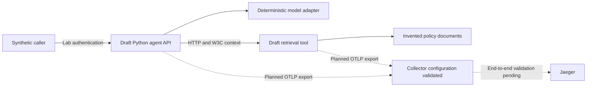
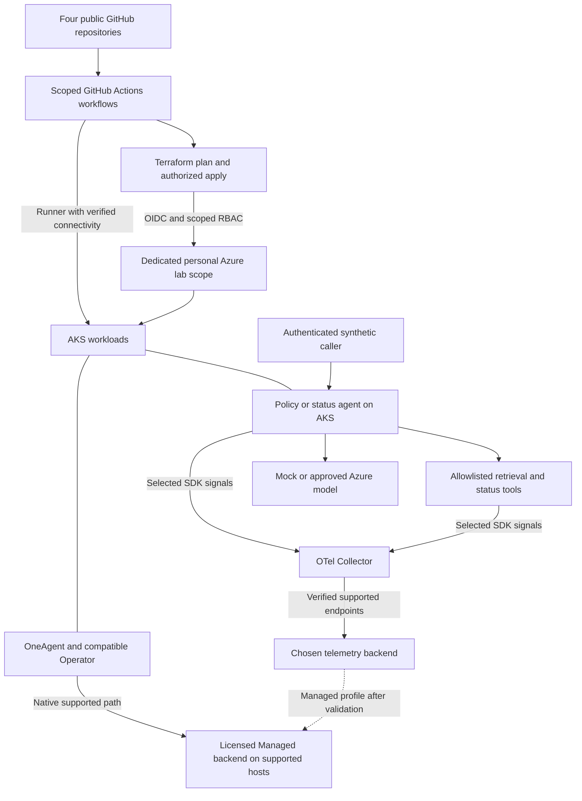
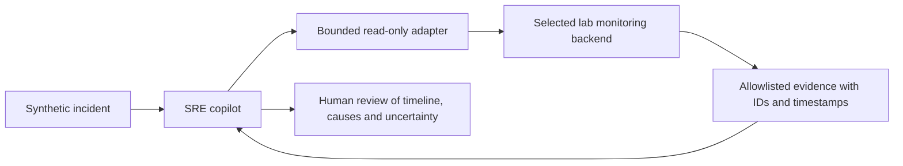

# High-level design — current, target and remaining work

Version: 0.4 approved baseline. Updated: 28 October 2026, Asia/Dubai. Execution: **plan approved; public-source review and publication in progress**.

## Purpose

Provide three synthetic use cases: a policy assistant, a service-status agent and a read-only SRE copilot. Observe AI workload behavior separately from using AI to investigate monitoring evidence. Use personal Azure/GitHub targets; preserve Dynatrace Managed as the preferred later compatibility profile.

Confirmed implementation choices: **Terraform owns Azure infrastructure**, Helm/Kubernetes manifests own workload/observability deployments, and four repositories under `javedkumail` separate resource ownership. All four were verified public and empty on 28 October 2026, as reported by the user. The infrastructure destination is `AI-Observability-Infra`; other names match the source folders. Source review and initial pushes remain pending. GitLab credentials remain intact. Engineering standards are defined in `docs/engineering-standards.md`.

## Current local draft

Solid arrows describe the local service behavior exercised in the earlier 18-test run. Dashed arrows remain unproven as a complete running backend path. Existing in-memory trace assertions do not establish Jaeger ingestion. Collector and Jaeger binaries are present; local lifecycle coordination still needs work. The draft CI has an unresolved dependency-lock input. No live model, Azure or Managed deployment is present.

## Proposed personal Azure target

This diagram is a proposed target, not deployment proof. Infra owns Azure, state, identity and budgets; workloads owns applications/images/deployments; observability-config owns shared telemetry/monitoring; lab owns coordination/evidence. A release manifest pins their tested versions. The OneAgent native path stays independent of the arbitrary Collector. Separate experiments compare instrumentation modes and duplication.

Azure choices remain open: exact subscription/tenant, region, node sizes, public/private connectivity, reachable CI runner, model/quota, retention and active/idle cost. A costed plan precedes cloud spending. Managed choices additionally require entitlement, approved host/storage sizing and version compatibility.

## Read-only SRE path — planned

The adapter cannot execute arbitrary queries, shell commands or Azure/Kubernetes writes. Managed uses verified supported APIs; SaaS-only DQL/Grail, if selected, has separate configuration. Monitoring text is untrusted data. Every substantive claim references evidence or declares uncertainty.

## Nonfunctional design

- Operational metadata is the default capture policy; prompts, completions, documents, arguments and secrets stay out of telemetry.
- Fixed service/environment/version identity and W3C context enable cross-service trace validation. Metrics avoid user/conversation/trace labels.
- Execution and telemetry queues/retries are bounded. Mock token usage stays null; actual token budgets and dated cost estimates require a live provider.
- Synthetic load, short retention, explicit lifecycle commands and scoped IaC contain lab consumption. Budget notifications are not a guaranteed spending cutoff.
- Local, cloud, live-provider, Managed and optional SaaS evidence is labelled independently.

## HLD change log and next boundary

| Version | Change | Validation state |
| --- | --- | --- |
| 0.1 | Documented existing drafts, proposed Azure/Managed target and separate SRE evidence path | Plan awaiting user review |
| 0.2 | Confirmed Terraform, four private repositories under javedkumail, GitLab coexistence, event-driven tracker and engineering standards | User choices recorded; implementation still paused |
| 0.3 | Verified four public, empty GitHub destinations created by the user; recorded exact infrastructure name | Read-only API evidence saved; no push or architecture boundary change |
| 0.4 | User approved the plan and public pushes; review sanitizes reference-environment names and fixes repository-local evidence links | Review passed: 18 workload tests, 11 tracker tests, zero staged secret findings; GitLab credentials preserved |

**What we are going to do next:** push and verify the reviewed source in all four repositories. Publication checks passed; GitHub authentication is verified. The next implementation package is the local vertical-slice review and backend validation.

**What remains:** backend ingestion/lifecycle evidence; repository/CI completion; personal targets and budget; costed Azure IaC/deployment; Managed entitlement and compatibility; status agent; SRE adapter/copilot; live-provider and comparison experiments; demo, rebuild and teardown.

After every work step the tracker supplies current status, next executable work and remaining decisions. Update this HLD whenever a component, boundary, ownership rule or telemetry path changes.

<!-- publication-progress -->

## Verified source publication

| Repository | Remote commit | Status |
| --- | --- | --- |
| ai-observability-infra | `b21c746acac6` | Remote main verified |
| ai-agent-workloads | `6fc332a2cddf` | Remote main verified |
| ai-observability-config | `9d81a64e0fea` | Remote main verified |
| ai-observability-lab | — | First push pending |

Source publication does not establish a running backend, active CI, Terraform deployment or Managed compatibility. Component ownership is unchanged.
