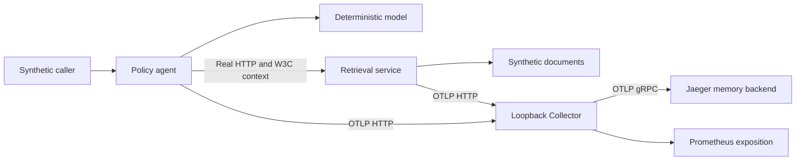
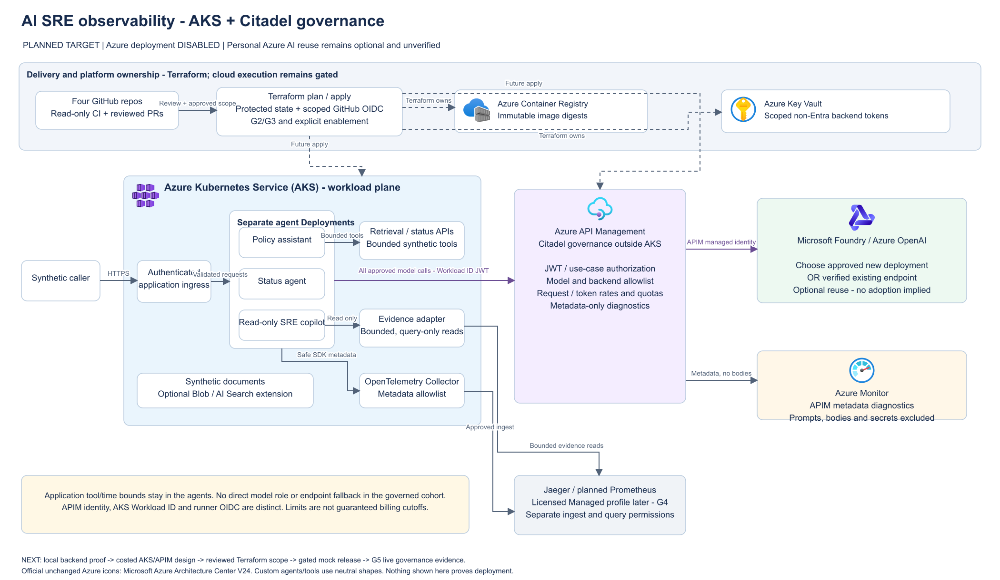
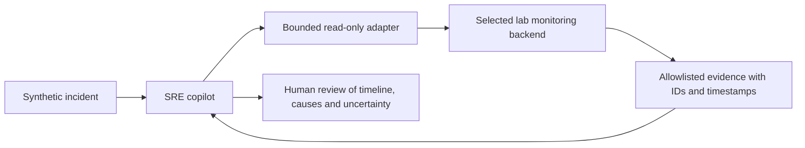

# High-level design — current, target and remaining work

Version: 0.34 Jaeger/application chart source validated. Updated: 15 November 2026, Asia/Dubai. Execution: **Collector/GitOps merges and main CI passed; Jaeger/application charts implemented in review; P2.13 continues; Azure disabled**.

## Purpose

Provide three synthetic use cases: a policy assistant, a service-status agent and a read-only SRE copilot. Observe AI workload behavior separately from using AI to investigate monitoring evidence. Use personal Azure/GitHub targets; preserve Dynatrace Managed as the preferred later compatibility profile.

Confirmed implementation choices: **Terraform owns Azure infrastructure**, AKS hosts Python agents/tools, and APIM outside AKS governs approved inference. The selected seven-repository organization separates resource ownership. The original four public repositories retain names/IDs/history; config and Collector/manual GitOps foundations are merged, Jaeger/application chart source is in review, and pipelines remains empty. Canonical local folders are prepared in the parallel AI-PLATFORM-LAB workspace; GitHub renames and Project cutover wait for P2.15. The private shared Project retains 48 task/issue identities and its four existing links. GitLab credentials/global Git settings remain intact. See docs/workspace-compatibility.md and docs/engineering-standards.md.

## Jaeger/application chart source implemented — 15 November 2026

[The prior step plan](docs/jaeger-application-plan.md) is implemented as a bounded source slice. [Charts #8](https://github.com/AI-SRE-Oberveability/ai-observability-config/pull/8) adds pinned ephemeral Jaeger: default zero/dev four/qa four objects, one memory-backed instance capped at 1000 traces, memory/batch/resource bounds, tokenless restricted settings, internal OTLP and loopback-only query listeners. Eleven negative cases pass. Generated config validates in the pinned native and digest-container distributions; socket/config checks are not backend/readiness, image-startup or pressure acceptance.

[Workloads #12](https://github.com/AI-SRE-Oberveability/ai-agent-workloads/pull/12) adds the existing mock agent/retrieval chart: default zero/dev six/qa six objects, distinct tokenless identities, internal Services, HTTP probes, restricted resources/security and bounded memory /tmp. Fifteen negative cases pass, including missing/zero images/source, inline keys, public service, faults and endpoint escapes. Positive renders use private labelled synthetic fixture images only. Enabling real source requires image/source/Secret-reference inputs; no published workload image, matching provenance, Secret delivery or runtime startup is established. Existing Python code still emits `local` telemetry attribution; profile labels do not fix it.

Both exact-source CIs pass, including existing application tests/build and chart/Collector checks. All old workload files except the extended CI workflow, seven retained telemetry profiles, the merged GitOps catalog, seven repository identities and global Git/original remote hashes are unchanged; see evidence/jaeger-application-validation.json and the matrix. No fixture values are committed or promoted into GitOps. Collector/GitOps approved main CI remains separate in evidence/p213-collector-gitops-merge.json.

Next: review the charts/workload/lab PRs, then address real workload image publication/replay and Secret delivery, telemetry environment attribution, GitOps values/catalog promotion, complete Argo/config ownership and full bootstrap/combined checks. P2.13 stays in progress, followed by P2.14–P2.16 and exact-target/costed Terraform gates. Azure stays false and GitLab/global Git is preserved; AKS Python agents, APIM outside AKS and Terraform ownership remain selected. Offline API baseline 1.35.0 is not an approved AKS target/version.

## Earlier Collector/GitOps merged; next chart slice planned — 15 November 2026

Charts #7, GitOps #1 and lab #38 are merged at their approved heads and exact resulting main CI passes; see evidence/p213-collector-gitops-merge.json. [The ordered next plan](docs/jaeger-application-plan.md) starts a pinned ephemeral Jaeger chart in charts and a disabled-by-default Python agent/retrieval chart in workloads. Config retains namespace/policy/CRD ownership. Application enablement requires image/source/Secret-reference inputs; no published workload image is yet recorded. Private render fixtures are explicitly not rollout evidence. Existing explicit `local` telemetry attribution is a known gap, not changed by profile labels.

Next: implement and validate both source charts with safe settings, then publish independent PRs and actual receipts. Remaining: workload image publication/replay, GitOps promotion, Argo/config GitOps and full bootstrap/combined checks; P2.14–P2.16 and exact-target/budget gates. Azure stays false, Python agents/APIM/Terraform boundaries are retained and GitLab/global Git settings are preserved.

## Earlier Collector/manual GitOps source implemented — 15 November 2026

[The step plan](docs/collector-gitops-plan.md) is implemented for this bounded slice. [Charts #7](https://github.com/AI-SRE-Oberveability/ai-observability-config/pull/7) adds the digest-pinned Collector chart: zero default objects; dev/qa alternative renders each contain four namespaced objects, with tokenless identity, restricted security settings, bounded resources, process probes and preserved metadata processors. Nine negative cases pass. Generated config validates with the pinned native binary and the exact digest container in CI; this is not image startup/backend or Kubernetes admission proof.

[GitOps #1](https://github.com/AI-SRE-Oberveability/ai-platform-gitops/pull/1) adds two narrow AppProjects/manual Applications with exact published chart/value commits and synthetic unregistered cluster names. Five public input blobs are checksum-verified; sixteen safety tests pass. The partial ownership ledger is PREPARED only, with no active writer or adoption receipt. Original Argo schema/licence provenance is retained. GitOps now has a documentation main baseline and implementation review branch; pipelines alone remains empty. See evidence/collector-gitops-validation.json and the matrix for exact source/CI bindings.

Next: review the concrete charts/GitOps/lab PRs, then implement ephemeral Jaeger and the Python application chart, complete Argo hardening/connectivity, config/platform GitOps and bootstrap/combined ownership checks. P2.13 remains in progress, followed by P2.14–P2.16 and exact-target/costed Terraform gates. Earlier main CI is preserved separately from new review CI; changed watched charts source still requires authorized merge/main revalidation. Azure stays disabled; GitLab credentials/global Git and original remotes, seven IDs and retained profile hashes are verified unchanged. AKS Python agents/APIM outside AKS and Terraform ownership remain selected.

## Earlier first configuration slice validated — 15 November 2026

[Current implementation and remaining work](docs/platform-configuration-progress.md). Config #1 now binds rendered CRDs to the exact locked upstream objects, preventing an authored assembly from substituting a schema while leaving unused originals intact. All 20 configuration tests pass locally and clean Windows/Linux CI passes at the matrix's exact config commit. Three builds produce 32 unique configuration-owned objects: four Namespaces, two quotas, two LimitRanges, two unbound read-only Roles, nineteen NetworkPolicies and three original CRDs. No application ServiceAccount, RoleBinding, Deployment or controller is created. See evidence/configuration-foundations-validation.json.

Dependency/renderer checks and corrected charts #6 CI pass. The disabled scaffold's enabled smoke is input/ownership evidence only; controller image digests, hardening, target connectivity and adoption remain unproved. All seven repo IDs/origins and local Git preservation hashes, existing telemetry profiles, two unseeded repositories and disabled Azure flags were reverified; see evidence/platform-configuration-preservation.json. Global Helm remains 3.19.0; selected 4.3.1 is private. No Azure/cluster apply or registry publication occurred.

Next: review the three concrete PRs, then finish platform/application chart profiles, GitOps immutable environment selections and bootstrap/combined checks. P2.13 remains in progress; source checks do not prove live admission/CEL, NetworkPolicy/PSA or backend behavior. Existing exact-main CI receipts are correctly stale/blocked after watched workflow changes until authorized merge/revalidation; branch CI does not replace them. P2.14 seven-repo CI, P2.15 cutover, P2.16 fresh canonical proof and exact-target/costed Terraform gates remain. AKS Python agents/APIM outside AKS, separate identities, safe telemetry and read-only SRE remain selected. Azure is false and GitLab credentials/global Git settings remain intact.

## Earlier input-locking publication snapshot — 15 November 2026

Argo CD 3.6.1 / chart 10.18.0, Helm 4.3.1 and Kustomize 5.8.3 are locked to verified upstream source/archive/executable bytes. Helm 4.3.1 is an intentional private match to the selected upstream renderer; the global Helm 3.19.0 installation is unchanged. Kubernetes 1.35.0 is an offline API/schema baseline only, not an approved or independently verified AKS version. Original Argo CRDs, selected strict schemas, official apiextensions OpenAPI components and licences are preserved under a 12-artifact raw-byte lock. Python validators are hash-locked. See evidence/platform-input-locking.json and tracking/platform-render-matrix.json.

Config source is published in [config PR #1](https://github.com/AI-SRE-Oberveability/ai-platform-config/pull/1); dependency scaffold/checks are in [charts PR #6](https://github.com/AI-SRE-Oberveability/ai-observability-config/pull/6). Exact source commits are bound in the matrix. Config CI passes on Windows/Linux; corrected chart CI passes, retaining its initial lint failure in evidence/platform-configuration-attempts.json. The scaffold renders zero objects by default; explicit offline smoke renders 56 with no config-owned Namespace/CRD. No controller profile is deployable.

Next: finish configuration/source-preservation acceptance and publish its final receipts. Remaining: platform/application chart profiles and controller image/hardening/connectivity, GitOps environment pins and bootstrap handover/combined checks, seven-repo CI, identity-preserving cutover and fresh canonical runtime proof. Existing exact-main workflow receipts become stale when watched chart CI changes; PR CI does not replace post-merge main evidence. Azure remains false; AI agents/APIM/Terraform boundaries and GitLab/global Git settings are preserved.

## Earlier approved implementation-start snapshot — 15 November 2026

The user approved the ownership plan and explicitly authorized merging PR #36 and starting dependency locking/configuration manifests. Verified head eae5bfe9a12927ad6cd3d3e4204346d0358cbc21 merged as d947613b318e693584d7e637131d079df89f51ef; exact-head and new exact-main CI passed. See evidence/pr36-merge.json and evidence/platform-configuration-start.json.

The config repository now has a reviewed four-file documentation/ignore baseline on main, with a configuration implementation branch. Its commit uses a repository-local GitHub noreply identity; no global helper/credential setting changed. See evidence/config-repository-bootstrap.json. Next: verify/lock selected upstream bytes and implement namespace, policy, RBAC and CRD source with offline builds/negative checks. The approved first slice and ownership/handover rules apply. Dependency selection records an offline API/rendering baseline, not an approved AKS deployment version or cloud target. No installation, Argo sync, Azure authentication or resource operation is authorized by this step.

Python agents remain on planned AKS through APIM outside AKS; Terraform owns Azure/APIM. Safe telemetry, read-only SRE and separate identities remain unchanged. Remaining: configuration validation/publication, platform/application charts, GitOps/handover checks, P2.14 seven-repo CI, P2.15 cutover, P2.16 fresh canonical proof, then exact targets/budget and costed cloud planning. Azure stays false and GitLab/global Git settings are preserved.

## Earlier P2.13 planning snapshot — 15 November 2026

[The detailed plan](docs/platform-ownership-plan.md) and [seven-role blueprint](tracking/platform-ownership-plan.json) define resource authorship, future folders, a small dev-first slice with offline qa parity, locked inputs, real-commit publication order, an explicit bootstrap freeze before Argo adoption, rollback and negative checks. Config owns namespace/foundation RBAC/policy and selected CRDs; charts owns generic platform templates; workloads owns the Python application chart; GitOps owns environment values and pinned release selections. Infra remains the Azure/APIM owner and only orchestrates temporary bootstrap writes from those same sources. No two desired-spec writers are allowed after handover.

The reference's 298 files still match the reviewed bytes, all seven retained telemetry/profile files match, and three new repos remain empty. The coherent plan preserves the 48-task graph and registers actual/future implementation watch paths. Existing code passes the 68-test Windows suite (65 executed, three platform/privilege skips) and Ruff checks; merge/main CI is separately evidenced. See evidence/platform-ownership-inventory.json and evidence/platform-ownership-plan-review.json. These checks do not implement a resource validator or prove Helm/Kustomize renders, live Argo handover, AKS security or backend traffic.

P2.13 stays in progress. Next: review the plan, select/lock compatible tool/Argo/chart/CRD inputs, then establish config source, platform/application charts, GitOps and the offline ownership/handover checks in that order. Optional Gateway/mesh and extra reference services remain proposed deferrals in this review package. Remaining: actual P2.13 source/renders/publication; P2.14 seven-repo CI; P2.15 identity-preserving renames/Project cutover; P2.16 fresh canonical proof/source baseline; then exact Azure targets/budget and costed Terraform planning. Deployment remains disabled; Python AI agents/APIM boundaries, safe telemetry, read-only SRE and GitLab/global Git settings are preserved.

## Earlier PR #35 merge/P2.13 start snapshot — 15 November 2026

The user explicitly authorized merging PR #35 and starting P2.13 with ownership planning first. Approved head 26635b044344da0f39440889577d92cc0335f77b merged as 28fb2bfc8285f037843100f4a2f4bc2d533b04f8; exact-head PR/push CI and the new exact-main CI passed. See evidence/pr35-merge.json and evidence/platform-ownership-start.json. P2.12 path compatibility is now on main; original PR #25 and its receipts/history remain preserved.

P2.13 first defines the configuration, charts and GitOps resource boundaries, exact future folders, dependency locks, bootstrap-to-Argo handover, negative checks, publication sequence and rollback. This step changes coordination documents/evidence only. The config/GitOps/pipelines repositories remain empty; no chart, manifest, controller, CRD, bootstrap installer or reusable workflow is added yet. Keep one source owner and one active spec writer for each resource.

Runtime remains Python agents on AKS -> APIM outside AKS -> approved endpoints. Terraform owns Azure/APIM; metadata-only telemetry, separate identities and read-only SRE remain required. Next: inventory and publish the concrete P2.13 ownership plan before source implementation. Remaining: P2.13 source/renders/handover checks, P2.14 seven-repo CI, P2.15 rename/Project cutover, P2.16 canonical backend/source baseline, then exact targets/budget and costed Terraform planning. Azure is false; G2/G3/G4/G5 remain pending and GitLab credentials/global Git settings stay intact.

## Earlier P2.12 workspace acceptance snapshot — 15 November 2026

Created empty public config, gitops and pipelines repositories with verified IDs; all seven canonical sibling clones now exist under AI-PLATFORM-LAB. The three new repos have read-only workflow permissions, no PR approval permission, an explicit false Azure flag and no branches/workflows yet. Four original GitHub names, source histories and rollback workspace remain unchanged. See evidence/workspace-setup.json.

The shared registry/resolver now connects tracker, Project evidence links, native/Linux runners, installer, generated Compose and historical release-object reads. PR #25's Linux source/tests and historical receipts/audit were selectively reconciled without importing its old 41-task state. R1 runtime containment no longer depends on clone names; R2 platform fixtures allow Windows tests while real POSIX signal tests run on Linux. New tracker records explicitly normalize authored UTF-8 text to LF. Historical raw proof hashes/dates/notes remain unchanged; a fingerprint-bound checkout envelope is added only where every legacy source/evidence byte still matches its original receipt. P1.5/P1.6 changed runner receipts remain stale. The initial clean-checkout line-ending failure is retained in evidence/canonical-checkout-attempt-1.json. A second attempt isolated P2.9's two generated Terraform provider-cache files; evidence/canonical-checkout-attempt-2.json preserves it. Portable source comparisons now explicitly exclude that generated cache, with original hashes retained and the exact exclusion listed; the explicit correction and negative regressions are recorded in evidence/tracker-checkout-compatibility.json. Project updates verify published evidence blobs and use immutable commit links before writes.

The 68-test suite passed in both real layouts on Windows (65 executed, three platform/privilege skips) and Ubuntu WSL (all 68 executed, zero skips). Both actual Compose configuration renders passed with four services, correct sibling build contexts and loopback bindings; no engine action occurred. Both Windows/Linux layouts verified the 18 historical pinned source objects. Native installer/runner imports resolved the correct private runtime and sibling profiles. See evidence/migration-path-compatibility.json. This is path/unit/config validation, not fresh backend ingestion. PR #35 publishes the reviewed implementation. Exact-source CI passed at 337676f7c44012e0fe2302a8eb004bd0cf53b70c. All seven canonical clones are clean, tested source bytes match the Git checkout, and all 48 task statuses agree with the preserved legacy layout. See evidence/canonical-workspace-checkout.json and evidence/workspace-compatibility-publication.json. P2.12 is locally accepted on the review branch; publication review found no confirmed secrets. Next: review/merge PR #35 under applicable authorization, then P2.13 owned platform/GitOps source. Final tracker/Project receipts use published immutable evidence links. Remaining: review/merge, P2.13 owned platform/GitOps source, P2.14 seven-repo CI, P2.15 rename/Project cutover, P2.16 fresh canonical runtime proof/source baseline, then target/budget and costed Terraform planning. Azure and paid/live inference remain disabled, and GitLab credentials/global Git configuration are preserved.

## Earlier P2.12 start snapshot after approved PR #34 merge - 15 November 2026

The user explicitly authorized merging PR #34, fixing the two PR #25 findings and preparing/testing the seven-repository workspace. PR #34 merged at 9fc2224161e4e080f24dfbc97c37c5fb7eb78904 after its exact approved head passed CI; see evidence/pr34-merge.json. The rollback baseline and original PR #25 branch remain preserved.

Next: create the three planned empty public repos, prepare canonical isolated clones without renaming the four existing GitHub repositories, implement the shared safe old/new layout resolver, and correct runtime containment plus platform-specific tests. Validate tracking, Project evidence links, native/Linux runners, Compose, workspace files and historical release-object reads in both layouts. Keep the 48-task model and historical evidence; do not import the old feature's generated state wholesale.

Runtime remains AI agents on AKS through APIM outside AKS. Azure deployment and paid/live inference remain disabled, G2/G3/G4/G5 stay pending, and GitLab credentials/global Git settings are preserved. Repository rename/Project cutover and fresh canonical runtime proof remain later work packages.

## Preserved baseline and completed PR #25 review - 15 November 2026

P2.11 now has an immutable post-PR26 baseline: four original repository IDs and exact main/branch/tag refs, settings/protections and issue identities, a private 48-item Project snapshot, locked source objects, and four local Git rollback bundles. Each bundle passed verification, independent mirror restore and full fsck; the lab PR refs were restored too. See evidence/migration-baseline.json and evidence/migration-baseline-validation.json. Lab main CI 43722081314 passed at merged commit 36944db6ab12fdec949317cef4666cab1814337b; unchanged sibling CI receipts remain historical exact-source results.

[The review and integration sequence](docs/migration-baseline-review.md) inspected PR #25 at dde301710f21fe7d8a99f1a9e20000291f836555. All 51 stdlib tests passed in Ubuntu WSL. Two corrections were reproduced: POSIX runtime-path containment depends on obsolete clone names, and a mocked Linux-specific test fails through the common Windows entry point. Six HLD/generated-tracker/audit-state conflicts require deliberate reconciliation with the accepted 48-task plan. PR #25 remains draft, unchanged and unmerged; its historical runtime proof has not been replayed or adopted as new migration acceptance. See evidence/pr25-review.json.

The baseline/review work package is complete; next is P2.12's isolated workspace and shared old/new path/runtime resolver, including those corrections before integrating the Linux runner. Preserve both audit histories and profile-specific receipts, regenerate derived views, and retain the old workspace. No repository creation/rename/cutover has occurred. Runtime remains Python AI agents on AKS through APIM outside AKS, with safe telemetry and read-only SRE. Azure is false and G2/G3/G4/G5 remain pending; GitLab credentials/helpers/remotes and global Git settings remain intact.

## Earlier migration-start snapshot: approved plan merged - 15 November 2026

The user approved the finalized plan and explicitly authorized merging PR #26 and starting the seven-repository migration with baseline preservation and PR #25 review. PR #26 merged at 36944db6ab12fdec949317cef4666cab1814337b after exact-head CI passed; see evidence/pr26-merge.json. This starts P2.11. The earlier planning-only statements below and in the approved plan describe that package's publication snapshot.

Next: preserve exact repository IDs/heads/refs/settings, create verified local Git rollback bundles, capture Project mappings, and review the Linux Compose runner/tests/evidence at PR #25's exact head. Review the overlapping tracking/HLD changes against the merged 48-task plan before choosing its integration path. PR #25 has not been authorized for merge by this instruction and remains a review input.

The seven canonical names and ownership remain selected. Runtime remains Python agents on AKS -> APIM outside AKS -> approved endpoints. No repository rename, folder move, resource creation, Azure authentication or paid/live inference is part of this baseline step. Azure deployment is false; GitLab credentials and global Git configuration are preserved. Cloud/Managed/live-model gates remain pending.

## Selected repository structure and next work - 15 November 2026

The user selected the seven-repository structure and requested finalized names and a step-by-step plan before migration. The current plan is [repository-migration-plan.md](docs/repository-migration-plan.md), with [ADR 0002](docs/adr-0002-seven-repositories.md), a seven-role blueprint and a complete planning snapshot of 173 tracked source paths. Earlier review text below records the proposal before this selection and is superseded for current status.

| Canonical repo/folder | Ownership | Planned operation |
| --- | --- | --- |
| ai-platform-infra | Terraform Azure and APIM | Rename existing infra, preserve ID/history |
| ai-platform-config | Cluster/namespace configuration source | Create new |
| ai-platform-charts | Platform charts and local/native telemetry profiles | Rename existing observability config, preserve ID/history |
| ai-platform-gitops | Argo environment desired state and immutable promotion | Create new |
| ai-platform-pipelines | Reviewed reusable CI and guarded delivery templates | Create new |
| ai-agent-workloads | Python AI agents/tools/contracts/evaluations/application charts | Retain existing name/history |
| ai-platform-lab | HLD, tracker/Project, evidence, release/workspace coordination | Rename existing lab last, preserve ID/history |

The runtime remains AKS agents -> APIM outside AKS -> approved model endpoints, with separate runner, pod and gateway identities, metadata-only telemetry and read-only SRE. Config/charts/workloads own authored definitions; GitOps selects their tested revisions and Argo reconciles them after explicit bootstrap handover. No object has two writers. Mesh and actual Argo deployment still require their selected-profile acceptance. Optional Node/UI repositories are deferred outside this seven-repo scope.

Next: preserve/reconcile remote heads and drafts #25/#26, prepare old/new path compatibility in a parallel workspace, review platform/GitOps source, establish seven-repo offline CI, perform identity-preserving cutover, then prove the canonical checkout and seven main CI results. Track this as P2.10-P2.16, with original task IDs/receipts preserved. Planning is complete; these execution steps have not begun. P2.4 image/digest/replay acceptance waits for migration exit.

The user reports obtaining an Azure Owner subscription. This is recorded without asserting verified account access: no Azure command, login or inventory was run. After repository setup, confirm exact personal tenant/subscription, region and budget/currency and produce a costed Terraform/APIM scope before deployment. G2/G3/G4/G5 remain pending. P3.1 depends on migration exit so that target/registry decisions can precede any Azure-dependent image publication. Azure deployment is false; GitLab credentials and global Git settings remain intact.

## Earlier repository structure review - 15 November 2026

Historical review before the selection above: the user supplied an AI-PLATFORM-LAB scaffold for review. [The assessment, proposed mapping and migration sequence](docs/platform-structure-review.md) distinguish its seven intended repositories from our current four Git histories. Its separation of Terraform, cluster configuration, charts, Argo desired state and reusable CI is useful; the Python AI workloads and evidence-backed lab tracker must remain explicit owners. A seven-core-repository layout plus two optional synthetic application repositories is proposed, not selected. No clone alias, remote, repository, source layout or runtime design has changed.

Static review recorded 16 successful Helm renders, four Kustomize builds, 17 JavaScript syntax checks, five PowerShell parses, ten JSON and 116 non-template YAML parses, Terraform formatting on an identical copied source tree, and zero Gitleaks findings. Three chart dependencies and the referenced Gateway API CRD bundle are missing. The scaffold's automatic apply, PR-trusted privileged identity and admin Kubernetes access must not replace our guarded delivery. See evidence/platform-structure-review.json; none of these checks proves deployment or runtime acceptance.

PR #24 is now confirmed merged into lab main 7723a733b67e1992e3eb7a37e148e85be9321406 on 2 November 2026. Its candidate remains source-pinned and non-deployable; no existing release pin or historical evidence has been rewritten. Next: the user's structure selection, then exact old-to-new paths and isolated migration PRs. AKS, Terraform and APIM remain the target runtime boundaries; Istio/Argo additions remain proposals. Azure deployment is false, G2/G3/G4/G5 remain pending, and GitLab authentication/global Git configuration are preserved.

[Draft documentation PR #26](https://github.com/AI-SRE-Oberveability/ai-observability-lab/pull/26) publishes the assessment and now the finalized names/plan following the user's seven-repo selection; no migration executes in this planning PR. Existing draft Compose-proof PR #25 was observed and left untouched; reconcile it before moving runners or changing release acceptance. See evidence/platform-structure-publication.json. The prior review snapshot was 18/41 accepted tasks; the selected migration plan adds seven explicit tasks, with finalization tracked separately from execution.

## Verified local deterministic slice

The Windows loopback profile now has actual backend evidence: the healthy request produced exactly seven spans across two services with expected parents; a synthetic dependency 503 returned tool_error after two attempts. Collector file exports, queried Jaeger data, metric surfaces and controlled operation logs passed canary checks. Resource service/version/environment identity was checked. All owned listeners stopped; Jaeger restart returned 404 for the prior trace. See evidence/local-backend-proof.json and docs/local-backend-runbook.md.

All 18 workload tests pass without the previous TestClient warning. This is one deterministic healthy/fault cohort, not live model, P6 coverage/overhead, durable delivery, Compose, Azure or Managed proof. The native runner uses a pinned internal Jaeger read API for this bounded proof; production read adapters remain separate.

## Proposed AKS and Azure AI target

[Editable architecture board](https://www.figma.com/board/JxOlJjtrEmIFrhRU8ltID0) and [implementation plan with all three views](docs/architecture/README.md).

[Editable draw.io](docs/architecture/azure-governance.drawio) | [SVG preview](docs/architecture/azure-governance.svg) | [Governance plan](docs/architecture/governance-plan.md). Six unchanged official Microsoft Azure icons are embedded; custom agents/tools use neutral shapes.

AKS hosts separate policy/status/SRE Deployments, bounded tool APIs and the Collector. Approved live model calls pass through a separate Azure APIM service implementing the selected Citadel-inspired governance boundary. Per-service AKS Workload ID supplies gateway-scoped pod identity; APIM managed identity supplies scoped model access. GitHub OIDC remains a separate deployment identity boundary. Governed agent identities receive no direct model-inference role. Proposed namespaces are ai-lab, observability and experiments. Helm/manifests remain with their owning workload/monitoring repositories; Terraform owns new Azure infrastructure and scoped identity/state.

The user selected an **optional existing Azure AI project reuse path**. Candidate Foundry/OpenAI endpoints, project resources, Search/Blob, ACR/Key Vault or AKS are referenced only after personal ownership, compatibility, quota, networking and cost are verified. No resource inventory, migration, import or adoption has occurred. Custom agent runtimes stay on AKS; a Foundry-hosted agent would be a separate comparison profile.

The first cluster cohort retains the deterministic model and bundled synthetic documents. Approved live-model and optional RAG cohorts follow later. Blob/Search, Prometheus storage and the expanded platform modules are proposed additions. The current Terraform code still covers one resource group; full AKS/ACR/Key Vault/networking and release deployment remain to implement.

Native OneAgent telemetry follows its supported route independently of the arbitrary Collector. Managed remains a licensed, version/sizing-gated backend on supported hosts. Read-only SRE adapters use only bounded, verified backend reads. No SaaS-specific feature is assumed on Managed.

Personal targets/region/budget, node/storage/network/runner sizing, retention, model quota and active/idle costs remain open. This diagram records the intended design, not deployed resources or cloud authorization.

## Read-only SRE path — planned

The adapter cannot execute arbitrary queries, shell commands or Azure/Kubernetes writes. Managed uses verified supported APIs; SaaS-only DQL/Grail, if selected, has separate configuration. Monitoring text is untrusted data. Every substantive claim references evidence or declares uncertainty.

## Nonfunctional design

- Operational metadata is the default capture policy; prompts, completions, documents, arguments and secrets stay out of telemetry.
- Fixed service/environment/version identity and W3C context enable cross-service trace validation. Metrics avoid user/conversation/trace labels.
- Execution and telemetry queues/retries are bounded. Mock token usage stays null; actual token budgets and dated cost estimates require a live provider.
- Synthetic load, short retention, explicit lifecycle commands and scoped IaC contain lab consumption. Budget notifications are not a guaranteed spending cutoff.
- Local, cloud, live-provider, Managed and optional SaaS evidence is labelled independently.

## HLD change log and next boundary

| Version | Change | Validation state |
| --- | --- | --- |
| 0.1 | Documented existing drafts, proposed Azure/Managed target and separate SRE evidence path | Plan awaiting user review |
| 0.2 | Confirmed Terraform, four private repositories under javedkumail, GitLab coexistence, event-driven tracker and engineering standards | User choices recorded; implementation still paused |
| 0.3 | Verified four public, empty GitHub destinations created by the user; recorded exact infrastructure name | Read-only API evidence saved; no push or architecture boundary change |
| 0.4 | User approved the plan and public pushes; review sanitizes reference-environment names and fixes repository-local evidence links | Review passed: 18 workload tests, 11 tracker tests, zero staged secret findings; GitLab credentials preserved |
| 0.5 | Organization created; all four public repositories transferred and local remotes updated | IDs/history/ownership verified; organization documentation pushed to all four repositories |
| 0.6 | Shared Project #1 links all four repositories and mirrors 36 task issues through event-driven synchronization | Live task/link/view checks and 20 tracker/sync tests passed; source/cloud validation boundaries unchanged |

**What we are going to do next:** prepare and validate a release candidate pinned to the four tested main commits. Keep the missing workload registry digest explicit, then review the candidate before selecting/publishing an image artifact.

**What remains:** immutable workload image publication and replay; release pinning acceptance; personal Azure targets/budget and costed platform/APIM IaC; Managed compatibility; status/SRE agents; live-provider/comparison experiments; demo/rebuild and cloud teardown.

After every work step the tracker supplies current status, next executable work and remaining decisions. Update this HLD whenever a component, boundary, ownership rule or telemetry path changes.

<!-- publication-progress -->

## Verified source publication

| Repository | Initial reviewed commit | Status |
| --- | --- | --- |
| ai-observability-infra | `b21c746acac6` | Pushed and verified |
| ai-agent-workloads | `6fc332a2cddf` | Pushed and verified |
| ai-observability-config | `9d81a64e0fea` | Pushed and verified |
| ai-observability-lab | `0d5cf9f01db8` | Pushed and verified |

The lab receipt pins the initial reviewed source commit; later coordination updates are descendants. Initial source publication alone did not establish backend delivery, CI execution or cloud/Managed deployment; later CI evidence is recorded separately. Component ownership is unchanged.

## Organization migration status

`AI-SRE-Oberveability` is created on GitHub Free, and authenticated membership verifies javedkumail as active owner. 4/4 repositories have transferred with IDs, commits and public visibility preserved. [Shared Project #1](https://github.com/orgs/AI-SRE-Oberveability/projects/1) is verified with 41 unique task issues, all four repository links, Delivery board and All tasks views. GitLab credentials and global Git helpers remain unchanged.

| Repository | Actual owner | Transfer verification |
| --- | --- | --- |
| AI-Observability-Infra | AI-SRE-Oberveability | transferred_and_verified |
| ai-agent-workloads | AI-SRE-Oberveability | transferred_and_verified |
| ai-observability-config | AI-SRE-Oberveability | transferred_and_verified |
| ai-observability-lab | AI-SRE-Oberveability | transferred_and_verified |

Organization grouping changes repository ownership and future OIDC inputs, not component responsibilities. Verify the actual new owner/repository OIDC subject before configuring Azure federation. No Azure federation was deployed before this move.

## Project setup continuation — 29 October 2026

The existing organization Project #1 was completed after browser reconnection and verified as AI SRE Observability POC. Project-capable authentication is verified as javedkumail with the user-approved project scope; no duplicate Project was created. The CLI uses isolated local configuration, and Git authentication setup was declined. Existing GitHub repository authentication remains available; no GitLab credential/global helper changes were made.

## Shared Project tracking design

Project #1 is shared across the four repositories. Managed issues mirror task acceptance, dependencies, gates and evidence; Project fields expose task ID, phase, responsible owner and exact evidence status. The board summarizes Todo/In Progress/Done. Synchronization is event driven after local work-step recording via scripts/sync_github_project.py --apply; there is no scheduled job. New authentication is limited to the separately approved GitHub CLI scope and does not alter GitLab credentials or global Git helpers.

The Project retains private visibility for authorized organization members. Public repository source and sanitized evidence remain public. Local plan/state are authoritative; human notes outside managed issue blocks are preserved. Draft, blocked and pending decisions remain distinct in Evidence status. A task moves to Done and its issue closes only when the local tracker accepts its evidence. Live verification checks issue identity/state, all managed fields, and repository links. Interrupted synchronization resumes from saved task mappings and discovers existing managed issues to avoid duplicates. See evidence/shared-project-completion.json for the setup receipt and evidence/shared-project-verification.json for the latest synchronization result.

## Actions implementation boundary — 29 October 2026

The user authorized four independent CI workflows plus guarded Terraform delivery. Current status: planning complete; implementation and GitHub runs pending. CI stays read only. Manual Terraform plan/apply will use separate protected environments and OIDC; the initial root covers only a tagged resource group. Cloud execution stays disabled until personal targets, budget, state and scoped identities are confirmed. No AKS/Managed resource or Azure identity is created in this setup. See docs/actions-delivery-plan.md. Next: implement CI, validate Terraform/guards, publish PRs, then capture actual workflow conclusions.

### Actions step 2 — source checks and protected environment setup

Four CI definitions now exist on review branches. A fresh hash-locked workload environment passed 18 tests (one existing test-client deprecation warning); tracker tests passed 20/20; deployment guard tests passed 11/11. Five workflow definitions passed actionlint after correcting context availability. Config source checks passed; Docker build/Collector validation await hosted CI. Terraform provider initialization succeeded; cross-platform locking and final Terraform validation are still being checked.

Both infra environments, azure-lab-plan and azure-lab-apply, are verified main-only with owner review and administrator bypass disabled. The repository deployment flag is false; no Azure values, identities or roles were configured. GitHub reports an immutable OIDC subject prefix using organization/repository IDs; actual environment token/federation validation remains an Azure bootstrap prerequisite. Next: finish Terraform checks and reviewed PR publication, then capture real CI results.

### Actions step 3 — Terraform validation and review publication

Terraform foundation validation passed with AzureRM 5.11.0, and both mocked invalid-scope/expiry tests passed. Eleven Python safety tests cover disabled execution, branch/repository restrictions, target/context checks, reviewed-plan binding and destructive/scope-expanded plan rejection. Windows provider communication required a retry outside the restricted execution sandbox; no Azure login or cloud plan was run. Cross-platform package locking is still being collected; signed registry archive checksums already exist in the lock. Workload and observability PRs are open and hosted CI is running. Publication checks excluded generated Python cache files before the infra push. Next: complete all four PR checks and capture main-branch results; Azure execution stays disabled.

### Actions step 4 — all four PR pipelines validated

All four implementation PRs passed hosted CI. Workloads passed 18 tests and built its container; observability passed Compose and the real Collector validator; lab passed 20 tracker/sync tests; infra passed 11 safety tests, strict backend-disabled Linux init/validate and two mocked Terraform scope tests. The Linux lock mismatch was fixed by generating its real package hash from an official archive verified against signed registry metadata; strict readonly checks remain enabled. No cloud authentication or provisioning ran. See evidence/actions-pr-validation.json and evidence/actions-provider-lock-review.json.

The automatic approval review rejected merging workload PR 9 because explicit merge authorization was not present. At this review stage the PRs remained open. The user subsequently approved the four merges and final tracking receipt update; main CI and the live disabled-dispatch check are now verified in step 5 below. Both protected infra environments are verified main-only with owner review and no administrator bypass. AZURE_DEPLOYMENT_ENABLED remains false. No Azure target values, roles or identities were added. Source and global Git configuration checks preserve GitLab access.

```mermaid
flowchart LR
  PR[Four repository PRs] --> CI[Read-only CI: tests/build/config/Terraform]
  CI --> R[Explicit merge approval]
  R --> M[Main branch workflows]
  M --> D[Manual dispatch and deployment-enabled guard]
  D -.->|G2/G3 and bootstrap still pending| E[Protected plan/apply environments]
  E --> O[Separate OIDC identities]
  O --> S[Dedicated protected Blob state]
  S --> P[Private Terraform plan and review fingerprint]
  P --> A[Matching saved-plan apply: one resource group]
```

### Actions step 5 — verified activation after approved merges

The user explicitly approved the four named PR merges and the final HLD/tracker-only receipt update. All four PRs merged at their verified tested heads. All four resulting main-branch CI runs succeeded: workload tests/container build; observability source/Compose/Collector validation; lab tracker/sync tests; infra lint, 11 safety tests, strict locked Terraform initialization/validation and two mocked scope tests. The final documentation-only receipt PR is subject to the same CI checks.

The manually dispatched Terraform plan was intentionally tested with AZURE_DEPLOYMENT_ENABLED=false. It failed at the named preflight guard with the expected disabled-execution message; the entire Terraform job was skipped and Azure login did not run. This expected rejection is safety verification, not a failed Azure deployment. No target IDs, credentials, Entra identities, role assignments or Azure resources were created. GitLab credentials and global Git configuration remain unchanged. Exact source/run/merge evidence is in evidence/actions-main-activation.json and evidence/actions-disabled-deployment-verification.json.

**Current delivery boundary:** CI is active in all four repositories; manual Terraform plan/apply code and protected environments are configured. Actual Azure execution remains disabled pending G2/G3, state bootstrap, separate scoped plan/apply identities and verification of environment-specific immutable OIDC claims. The concrete Terraform root currently owns one tagged resource group. AKS/platform resources, registry publication, workload rollout, local backend proof, Managed and live models remain later work.

## Architecture step — 29 October 2026

Three editable diagrams now cover the AKS application target, telemetry/read-only SRE profiles and the CI-to-Terraform-to-AKS implementation sequence. The implementation guide defines namespace/resource ownership, separate runner/pod identities, optional existing-resource checks, cost/access gates and stage exits. The user chose an optional Azure AI reuse path; no existing cloud project is assumed available. The current accepted count remains 11/38: diagram completion does not close P1 backend, P3 cost/deployment, Managed or live-model tasks.

**Next implementation:** prove the local policy/telemetry slice, then confirm personal Azure targets and costs; build bootstrap/platform Terraform and image/release/Helm delivery before any approved AKS deployment. See docs/architecture/README.md for the full sequence and public design references. GitLab credentials and global Git configuration remain unchanged.

## Historical Citadel reference review — 1 November 2026

The later selection below supersedes the optional-only recommendation in this review; the review remains historical evidence.

Reviewed the user-provided [Citadel lab](https://microsoftlearning.github.io/mslearn-ai-governance/lab/) and its workshop/upstream documentation. The [fit review and proposed adoption sequence](docs/architecture/citadel-governance-review.md) records APIM as an optional governance experiment around approved live model calls. AKS remains the proposed custom-agent runtime, with separate OTel/backend and bounded read-only SRE paths. Terraform remains the sole Azure resource owner.

No gateway component, SKU, cloud scope or upstream code was adopted. Existing resource reuse stays optional and unverified. Privacy, source-version, networking, identity, cost and teardown differences must be resolved before implementation. Current diagrams retain the agreed baseline; a gateway view follows only if that experiment is selected.

**Next:** P1.1 local draft review, then real backend proof. **Remaining:** G2 personal targets/region/budget, G3 costed scope authorization, G4 Managed entitlement/compatibility, G5 live model/quota approval; platform Terraform, AKS delivery and experiments. The architecture proposal remains in PR #21; Azure execution remains disabled.

## Citadel/APIM selected in the target — 1 November 2026

The user requested inclusion of governance in the architecture and execution plan. [Three current views and retained baseline](docs/architecture/README.md) and the [governance work plan](docs/architecture/governance-plan.md) now cover AKS agents -> APIM outside AKS -> an approved new or verified existing Foundry/OpenAI model endpoint. This is design selection; resource sizing, costs and cloud execution remain unapproved.

Terraform owns APIM, backend/access inventory, identities, network/DNS, diagnostics and versioned XML policy fragments. Workloads own the governed adapter and bounded error/retry behavior; observability-config owns capture/correlation requirements; lab owns experiments and evidence. The application keeps tool/time bounds and read-only SRE controls. Gateway diagnostics follow an Azure Monitor route independently of the Collector; no trace continuity or supported Managed result is inferred from this drawing.

P3.7 tracks governance IaC before the concrete combined plan review; P5.5 tracks the gateway adapter; P6.6 tracks gateway/privacy/lifecycle evidence without making Managed a prerequisite. The shared plan now has 41 tasks, with 11 accepted deliverables. The earlier baseline remains labelled on the board and under docs/architecture/baseline-2026-10-29.

**Next:** finish P1.1 and local backend proof. **Remaining:** G2 targets/region/budget, costed AKS/APIM design and protected state/OIDC; G3 scope authorization; Terraform platform/gateway and AKS release; G5 live usage and governed validation; G4 Managed compatibility and later SRE/experiments. Azure deployment remains disabled and GitLab credentials/global configuration remain intact.

The user also selected a draw.io companion using official Azure icons. Its editable source, standalone SVG/PNG and icon provenance/rights notice are published with this design. The original FigJam views remain labelled baselines, and the three current views are added. Figma Starter quota prevented the final telemetry caption re-export; the documented flow, source and independent draw.io companion remain available. No Azure enablement or GitLab credential change occurred.

## PR #21 merged; local proof started - 1 November 2026

The user explicitly authorized merging PR #21. The verified head f59c9a48a73191c2efaec6f4976b6382b2e8407d passed CI and merged as dec89a84160bea68cd1f5d0a37aa54f4aaad95b3. The AKS/APIM design and official-icon diagram are now on main. See evidence/pr21-merge.json and [the local proof plan](docs/local-backend-proof-plan.md).

Current runtime evidence still covers the prototype and in-memory tests, not completed backend ingestion. Next: P1.1 application/contract/dependency review, then a bounded real Collector/Jaeger run. Cloud sizing, Terraform platform, Managed and live-model gates remain pending. Azure deployment stays disabled; GitLab/global Git credentials remain intact.

## Local review completed - 1 November 2026

P1.1 reviewed the policy/retrieval contracts, deterministic adapter, bounds, capture policy and locked versions. The current baseline passed 18 tests with one known TestClient deprecation; the CI input gap is already resolved. See evidence/local-workload-review.md and evidence/local-review-baseline.json. This proves local HTTP/in-memory assertions only.

Next: replace the deprecated test transport with the existing loopback fixture and validate a separate native Windows Collector/Jaeger profile. Real backend retrieval, exported-data canaries and owned-process lifecycle remain to prove. AKS/APIM, Azure spending, Managed and live models remain pending; Azure deployment stays disabled.

## Contracts and native preparation - 1 November 2026

The deprecated TestClient test now uses the existing real Uvicorn/HTTPX fixture. All 18 workload tests pass without warnings, including both OpenAPI schemas, real tool HTTP, typed outcomes, exact in-memory span edges and metadata checks. Native loopback-only Collector/Jaeger configurations pass their actual pinned validators. See evidence/local-workload-correction.json and docs/local-backend-runbook.md.

The first real backend attempt retrieved healthy/fault traces and passed canary checks, then failed a restart assertion because an expected 404 was not classified as absence. That failed attempt is retained in evidence/local-proof-attempt-1.json; a corrected rerun is pending before full acceptance. The runner owns its processes, captures and cleanup. Cloud, Managed and live models remain unproved and Azure disabled.

## Local backend boundary accepted - 1 November 2026

The corrected one-shot proof passed after the first restart-404 assertion failure; both attempts are retained. P1.4/P1.5/P1.6 can be assessed from exported/backend data and owned-process lifecycle, independently of cloud scope. Next: publish the workload/config/runner review PRs and verify hosted CI. The new configuration-checker source invalidates its earlier main-CI receipt until review/merge/revalidation; the tracker exposes that dependency rather than assuming new code ran on main. Azure deployment remains false, GitLab/global settings unchanged, and all local services are stopped.

## Historical local proof publication - 1 November 2026 (now merged)

Workloads PR #11, observability-config PR #5 and lab PR #23 contain the test correction, native profiles and reproducible runner/evidence respectively. See evidence/local-proof-publication.json. Source review found no confirmed secrets; reviewed matches are source-file SHA256 receipts. At publication those follow-ups remained open; their later approved merges are recorded below.

All six P1 steps have local acceptance evidence. The tracker is 15/41 because P2.8 needs revalidation of the changed configuration checker on main, and P2.9 depends on that receipt. Hosted branch checks are tracked on the PRs separately. Next: review/merge follow-up changes, verify main CI, then complete multi-repository release pinning. No cloud gate is accepted. Azure deployment remains false; global Git settings match the preservation baseline and GitLab credentials were not changed. All owned local listeners are stopped.

## Local-proof PRs merged; release preparation - 1 November 2026

The user-authorized workloads #11, observability-config #5 and lab #23 merges are verified at their CI-passing heads. Exact merge commits are in evidence/local-proof-main-merges.json. Local code/configuration and evidence now share a main-branch baseline. Four main CI runs are being checked, including a fresh read-only infrastructure CI dispatch. No Terraform deployment was dispatched.

Next: restore CI receipts from passing exact-main results, then follow docs/release-pinning-plan.md to create a source-pinned candidate manifest and validation. The workload registry digest remains unknown; no image publication, release tag, Azure resource or rollout is implied. Azure deployment stays disabled, and GitLab/global Git credentials remain intact.

## Exact-main CI revalidated - 1 November 2026

Fresh CI passed for all four exact main commits, including a read-only infra dispatch. Workload clean-checkout tests/container build, config source/Compose/Collector validation, lab checks, and infra backend-disabled Terraform/safety/mocked tests are evidenced in evidence/main-ci-revalidation.json. The deployment flag is false and both Azure GitHub environments remain reviewer-protected/main-only with administrator bypass disabled. No deployment workflow or Azure login ran.

P2.8/P2.9 can be reaccepted from these results and the retained disabled-preflight proof; P2.3 now has the required clean-checkout CI/build evidence after local P1 acceptance. Next: prepare the source-pinned candidate and fail-closed image-readiness validation. The application OCI digest is still unknown, and P2.4 is not complete. GitLab credentials/global Git settings remain intact.

## Source-pinned candidate prepared - 1 November 2026

releases/local-v0.1.0-source-candidate.json freezes the four tested commits, main CI IDs, existing Docker base/backend digest references, two native package checksums and 18 selected Git-object hashes. The offline validator checked source/receipt consistency and rejected deployable readiness as expected. All 28 local tests pass (20 tracker/sync and 8 release-candidate checks). See releases/README.md and evidence/release-pinning-validation.json.

The candidate has no workload registry digest and cannot pass --require-deployable. Existing image digests have not been newly pulled/resolved in this step. The manifest lives in its containing commit while its lab execution pin stays on the tested merged runner baseline. Current CI permissions/workflows are unchanged. Next: review the candidate, then select/review a registry publication and immutable container-replay path. P2.4 stays in progress; Azure/cloud, Managed and live-model gates remain pending. GitLab credentials and global Git settings remain unchanged.

## Release candidate published for review - 1 November 2026

[Lab PR #24](https://github.com/AI-SRE-Oberveability/ai-observability-lab/pull/24) contains the candidate, validator/tests, exact-main CI receipts and merge receipts. See evidence/release-candidate-publication.json. The shared Project is at 18/41 accepted deliverables, with P2.4 in progress and no stale CI receipt. The candidate is not deployable: the workload image remains unpublished/unpinned, and the immutable container replay is pending.

The three requested PRs are merged. At this 1 November publication snapshot the preparation PR remained open; it was subsequently merged on 2 November, as recorded in the current structure-review section above. Azure deployment is still false; no registry publication, release tag, Azure authentication or resource operation took place. Global Git settings match the preservation baseline and GitLab credentials were not changed.
