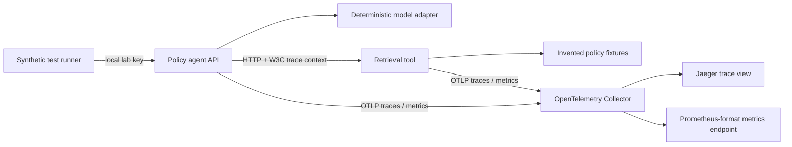

# Architecture and resource ownership

| Directory / proposed repository | Sole ownership | Current state |
| --- | --- | --- |
| ai-agent-workloads | APIs, contracts, fixtures, images, app deployment | Local implementation and workload CI definition |
| ai-observability-config | Collector, trace backend, telemetry contract, future Operator and dashboards | Local configuration; Managed/SaaS prerequisite records |
| ai-observability-infra | Azure, bootstrap identity, state, budgets, eventual AKS and optional Managed hosts | Design and placeholders only |
| ai-observability-lab | Coordination, release manifest, experiments, evidence, instructions | Local coordinator and documentation |

The parent is a multi-repository workspace, not a repository containing nested repositories. The four independent GitHub repositories under javedkumail now contain reviewed source; exact names and initial commits are in the repository mapping and publication receipts. Keep the original handoff outside published repositories, especially before any public release.

Cloud target: authenticated ingress to the agent on AKS, workload identity and secret delivery, synthetic tool services, optional approved Azure model. The native OneAgent path leads to its supported Dynatrace infrastructure; it never passes through this arbitrary Collector. Explicit custom spans may use a supported SDK/Collector path after endpoint validation. Monitoring configuration has one owner per resource.

Read-only SRE path (not implemented): synthetic incident -> profile-specific monitoring adapter -> bounded evidence -> explanation with evidence IDs -> human review. Managed APIs and optional SaaS Grail/DQL configuration must stay separate.
