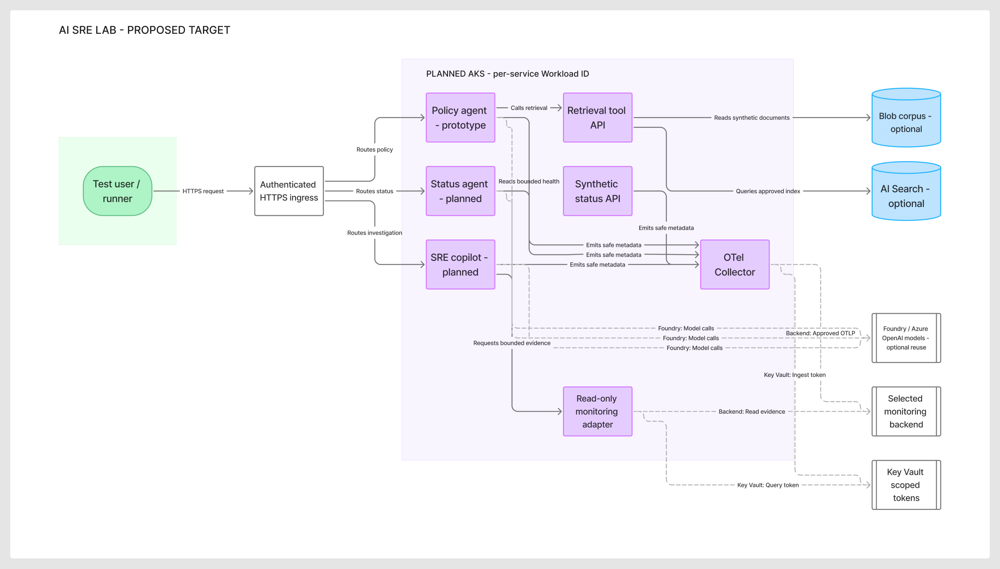
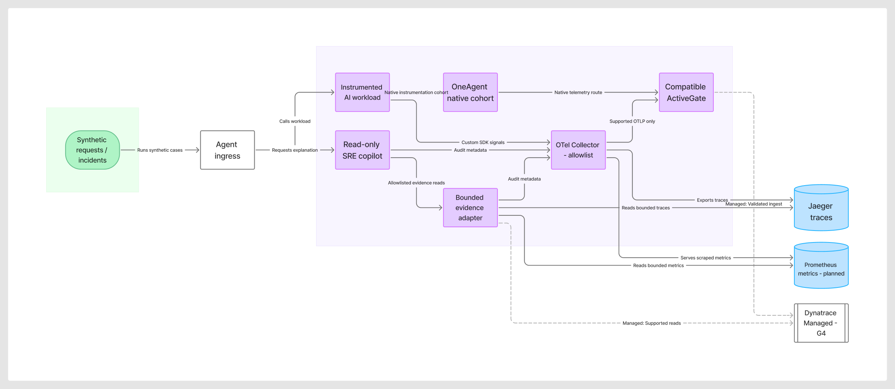
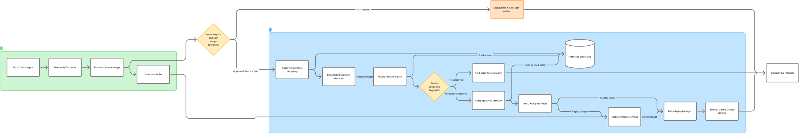

# AKS AI agents and observability architecture

Prepared 29 October 2026, Asia/Dubai. **Proposed target and implementation plan; Azure components are not deployed.** The user selected an optional reuse path for existing Azure AI projects. No Azure resource was discovered or adopted during this diagram work.

[Editable architecture board](https://www.figma.com/board/JxOlJjtrEmIFrhRU8ltID0). Sources: [runtime.mmd](runtime.mmd), [telemetry.mmd](telemetry.mmd), [delivery.mmd](delivery.mmd). These Mermaid files remain editable independently of FigJam. PNG/SVG files are stable previews of the generated diagrams.

## 1. Application target

AKS is the proposed Kubernetes execution platform. The policy, status and SRE APIs become separate Deployments with bounded tool services. The existing policy API, retrieval contract, synthetic fixtures, tests and Dockerfile supply the first slice. The status and SRE implementations remain planned.

The first AKS cohort keeps the deterministic model and bundled synthetic documents, matching the local baseline. Subsequent approved cohorts replace the model adapter with an Azure model endpoint and optionally add Blob/AI Search retrieval. The runtime diagram shows the expanded target; Blob, AI Search and existing Foundry/OpenAI reuse are optional, not mandatory baseline resources.

Custom agent/tool runtimes run on AKS. Approved Microsoft Foundry/Azure OpenAI resources supply model endpoints and, where selected, project-scoped evaluation/configuration. Foundry-hosted Agent Service would be a separate comparison profile; we will not represent it as an agent that also runs inside an AKS pod.

Authenticated ingress supplies TLS and application identity validation. Select the supported ingress/Gateway controller, exposure mode and DNS/certificates during the costed design. The closed local lab can start with port-forward access. No paid API gateway is assumed.

## 2. Observability and read-only investigation

The Collector applies a metadata allowlist, bounded memory/queues/retries and service/environment/version identity. Raw prompts, completions, documents, secret values and tool arguments stay out of exported telemetry by default. Retrieval/tool spans belong to the same W3C trace even when their instrumentation edges are omitted from the application overview for readability.

The initial trace backend is Jaeger; the current Collector exposes Prometheus-format metrics. A Prometheus server and its bounded retention/query path are planned additions, not an existing validated deployment. Backend ingestion and trace-graph/privacy proof remain P1.6 work.

The licensed Managed profile uses a compatible Operator/OneAgent/ActiveGate configuration after G4. Native OneAgent telemetry follows its supported route independently of the arbitrary Collector. Selected custom OTLP signals reach only individually verified endpoints. Run native/custom cohorts separately first, then measure duplication before combining them. The Managed backend stays on vendor-supported dedicated hosts; its entitlement, sizing, storage, version and cost are still open.

The SRE copilot calls an allowlisted evidence adapter. Each backend gets bounded read APIs, response/time limits and query-only scopes. Responses include evidence IDs/timestamps, uncertainty and human checks. Retrieved monitoring text is untrusted data. The adapter has no shell, arbitrary query execution, Kubernetes/Azure writes or automatic remediation. SaaS-only Grail/DQL is a separately chosen adapter/profile.

## 3. Delivery and trust boundaries

Four-repository read-only CI and the manual disabled Terraform preflight are verified today. Registry publication, platform modules and Kubernetes rollout remain planned. The current Terraform root covers one tagged resource group; the diagram's AKS/ACR/Key Vault platform is future work.

Bootstrap is an explicit prerequisite: after target and cost-scope approval, the confirmed personal operator establishes protected state and narrowly scoped federated identities. A pipeline cannot create the backend or identity it already needs to authenticate. Keep bootstrap, platform and optional Managed states separate.

GitHub OIDC authenticates the runner for approved infrastructure/release operations. AKS Workload ID authenticates pods to approved Azure services. They use different issuers, trust subjects and permissions. Neither identity is a GitLab credential.

| Boundary | Planned implementation |
| --- | --- |
| Infrastructure delivery | Separate plan/apply Entra identities, protected main-only GitHub environments, exact personal targets, scoped RBAC and reviewed plan fingerprint |
| Kubernetes delivery | Runner with verified API/network reachability, pinned Helm/manifests and image digests, namespace-scoped deployment permissions |
| Pod to Azure | Per-service Kubernetes ServiceAccount and federated workload identity; minimum model/search/blob roles |
| Non-Entra backend tokens | Key Vault/CSI or supported SDK retrieval with separately scoped ingest/query tokens; no values in Git or telemetry |
| Private endpoints/API | Choose DNS, endpoint and runner routes together; authentication does not establish network connectivity |
| Existing resources | Reference verified personal resource IDs; do not silently import, migrate, replace or destroy them |

Use a reachable isolated runner if the selected private AKS API cannot be reached from the default hosted runner. A bootstrap runner must exist independently of the cluster it provisions. Its lifecycle/cost is part of the design, not an implicit always-on VM.

## 4. Kubernetes layout

| Namespace / resource | Target responsibility |
| --- | --- |
| ai-lab | Policy, status and SRE Deployments; retrieval/status/evidence tool Services; per-service identities |
| observability | Collector and selected baseline backend; later compatible vendor components after G4 |
| experiments | Bounded synthetic load/fault Jobs with cleanup and versioned scenarios |
| Deployment/Service | Immutable image digest, readiness/liveness/startup probes, explicit resource requests/limits |
| ResourceQuota/LimitRange | Bounded namespace consumption; scaling limits follow the approved cost envelope |
| NetworkPolicy/RBAC | Default-deny with explicit required service/IP/private-endpoint paths and least-privilege roles; choose an appropriate policy engine if DNS-aware rules are required |
| Workload security | Non-root app containers, restricted capabilities, read-only filesystem where compatible and reviewed secret mounts; vendor instrumentation permissions reviewed separately |

Select node pools, Kubernetes version, replica counts, storage, autoscaling bounds and ingress only after regional support and costs are checked. Do not add an HA or GPU footprint without an experiment that needs it.

## 5. Optional existing Azure AI project reuse

The user explicitly chose **show an optional reuse path for now**. Existing resources are candidates, not confirmed dependencies.

Before reuse, inventory only user-specified personal targets: tenant/subscription ownership, resource/project type, region, supported SDK/API, endpoint and model deployment/version, quota, RBAC, network access, data handling and ownership of state. A Foundry project is not an AKS namespace. Existing hub-based and current Foundry project types can have different capabilities and migration requirements; no migration is implied.

| Reuse candidate | Acceptance before use |
| --- | --- |
| Existing policy code | Keep the current contracts, fixtures and deterministic tests; add provider adapters without replacing the baseline |
| Foundry/OpenAI model endpoint | Personal ownership and permitted model deployment confirmed; endpoint/auth/SDK/quota and cost tested |
| Foundry project | Confirm project type and supported evaluation/connections; bind only the intended project resources |
| AI Search / Blob corpus | Synthetic approved data, compatible index/vector dimensions, read roles and reachable endpoints |
| AKS / ACR / Key Vault | Reuse only after explicit ownership, isolation, policy and lifecycle review; otherwise provision dedicated lab resources |

Infra owns new lab resources and their lifecycle. Existing resources remain externally owned references until a separately reviewed import/adoption decision is made. No customer account, document corpus or negotiated entitlement is assumed reusable.

## 6. Implementation sequence and exits

| Step | What we implement | Evidence required to exit |
| --- | --- | --- |
| A — Verified foundation | Reuse four repos, CI, shared Project and guarded foundation workflow | Existing main CI and disabled-preflight receipts |
| B — Local vertical slice | Review prototype/contracts, resolve dependency gaps, start/stop Collector and Jaeger; keep mock model | Cited answer plus bounded failure; backend trace edges and exported-data canary checks |
| C — Personal design | Confirm G2 targets/region/budget; inspect optional reuse candidates; cost node/network/storage/runner/retention choices | Dated active/idle cost and ownership/network design; proposed concrete scope |
| D — IaC bootstrap/platform | Approved bootstrap, protected state, scoped GitHub OIDC, Terraform AKS/ACR/Key Vault/network modules | Locks, validation/security checks, concrete reviewed plans and G3 approval before spending |
| E — AKS mock release | Publish images, pin release manifest, deploy namespaces/identities/Helm and baseline telemetry | Clean release smoke tests, trace/privacy proof, bounded resources and lifecycle |
| F — Azure AI/RAG cohort | Add approved live-model adapter and optional existing/new Foundry/Search/Blob integration | G5 usage authorization, supported auth/quota, grounded answers and actual available usage |
| G — Managed and SRE cohorts | Add licensed supported Managed profile, status tools and read-only evidence-citing copilot | G4 compatibility matrix, signal-by-signal ingest/read evidence and fault/injection bounds |
| H — Experiments/handover | Run controlled coverage/duplication/overhead tests, rebuild and scoped cleanup | Versioned measurements, demo, residual-charge inventory and teardown proof |

Steps F/G can be developed with local fixtures while their live prerequisites are pending. Targets such as 95% coverage in a 100-request cohort and the overhead threshold remain measurements to prove, not current results.

## 7. Repository ownership

| Repository | Implementation ownership |
| --- | --- |
| AI-Observability-Infra | Terraform bootstrap/platform/Managed roots, cloud identities, state, networking and cost controls |
| ai-agent-workloads | Agent/tool contracts and code, fixtures, images and application Helm/manifests |
| ai-observability-config | Collector/backends, instrumentation/vendor configuration, telemetry contracts, dashboards and monitoring read profiles |
| ai-observability-lab | HLD/diagrams, task tracking, release manifest, experiment orchestration and sanitized evidence |

Current accepted count remains 11/38. These diagrams elaborate the proposed target; they do not close Azure, local backend, Managed or live-provider delivery tasks. Azure execution remains disabled. GitLab credentials and global Git helpers remain unchanged.

## Design references

- [AKS Workload ID](https://learn.microsoft.com/azure/aks/workload-identity-overview) — pod-to-Azure identity boundary.
- [Key Vault CSI identity access](https://learn.microsoft.com/en-us/azure/aks/csi-secrets-store-identity-access) — scoped secret delivery options.
- [Foundry project scope](https://learn.microsoft.com/en-us/azure/foundry/how-to/create-projects) — project/resource relationships to verify before reuse.
- [Foundry network isolation](https://learn.microsoft.com/en-us/azure/ai-foundry/how-to/configure-private-link?view=foundry) — service-specific private endpoint requirements.
- [AKS baseline architecture](https://learn.microsoft.com/en-gb/azure/architecture/reference-architectures/containers/aks/baseline-aks) — topology choices to scale to the agreed POC budget.
- [Dynatrace OTLP endpoints](https://docs.dynatrace.com/docs/ingest-from/opentelemetry/otlp-api) and [classic ingestion checks](https://docs.dynatrace.com/docs/ingest-from/opentelemetry-classic/troubleshooting-classic) — validate the selected backend/version and each signal rather than inferring Managed parity.
